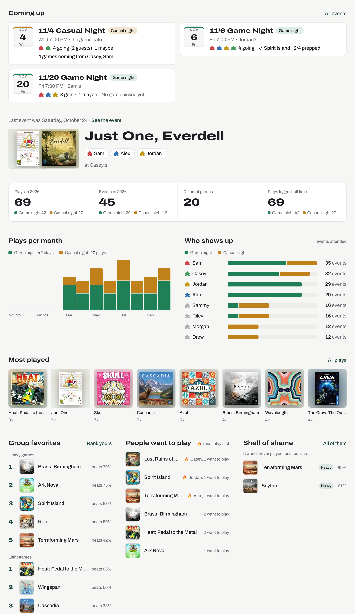
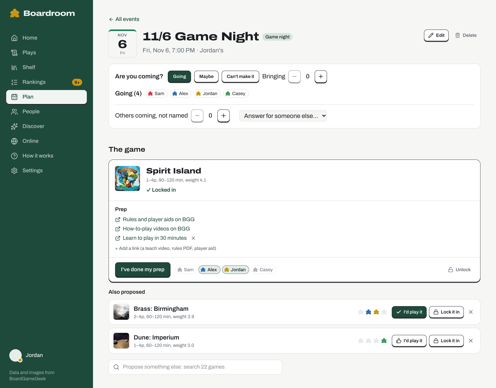
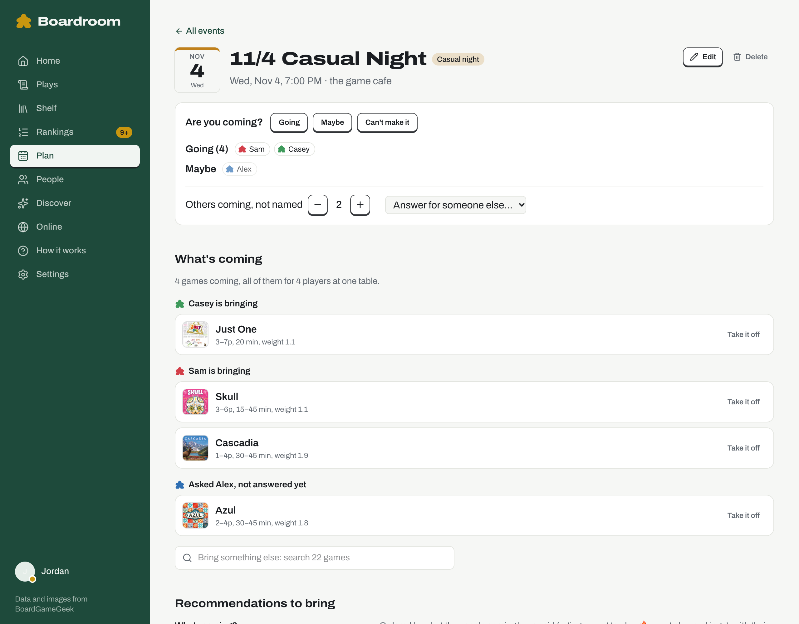

# Boardroom

A private site for a board game group that plays together regularly. It keeps the group's play history, what everyone thinks of each game, and a shared shelf built from everyone's BoardGameGeek collections. It also plans each game night: who's coming, what to play, and what to read or watch beforehand. Events and plays go to and from the group's Discord, and Claude can suggest what to play or buy next.

<picture>
  <source media="(prefers-color-scheme: dark)" srcset="docs/assets/screenshots/home-dark.jpg">
  
</picture>

Next.js 16 · React 19 · TypeScript · Tailwind 4 · Drizzle + SQLite (Turso) · Better Auth (Discord sign-in) · Claude API

## What it does

- **Getting set up.** Your first sign-in lands on one page with every step on it: find yourself in past plays, rate and rank the games you've played, and add your BGG collection and Board Game Arena name. Until rating and ranking are done, Home shows how far along you are.
- **Play log, kept in step with Discord.** Log a night's games from its event page, or on the Plays page, and they're posted to the group's channel. The morning after, whoever made the event gets a DM if nothing's been logged yet. Plays people write in Discord by hand are imported too, back to the channel's first message.
- **Ratings and rankings.** Rate games with a tap, and rank the ones you've played with quick "this or that?" questions. Heavy and light games are ranked separately, so a party game never has to beat a long strategy game. The group's favorites come from everyone's lists.
- **Events in Discord.** Make an event on the site or with `/event new`, and it's posted to the events channel with its own thread. People answer Going, Maybe or Can't make it with the post's buttons or on the site, and can answer for someone else, even someone who isn't in Discord yet. Changing the event in either place updates the post and tells the thread. A few hours before it starts, a reply on the post pings whoever's going or a maybe.
- **Finding a date.** Not sure when the next one is? Offer a few dates on Plan or with `/event poll`, and everyone taps the ones that work for them. Pick one and the poll's post turns into the event's post, keeping its thread, with a ping asking people to say if they're coming. Called one off by mistake? **Reopen** brings it back, votes and all. With a casual night on, a poll can be for either kind of night.
- **Planning a night.** Start from who's coming and get the shelf scored for that table: what they love, what they want to play, what hasn't been played in a while, and what suits the player count. Propose games, vote, lock one in, and the rules and teach videos are linked for prep.
- **Discover.** Games nobody owns, scored against everyone's taste with a calibrated "chance you'd like it", plus Claude's picks for the group or just for you.
- **A casual night too, if you have one.** A second, lighter night with guests, with its own channels and recommendations. Instead of voting on a game, people say what they're bringing, or ask whoever owns a game to bring it, and the bot DMs them to answer. When a casual regular wants in on the core group's nights, any member can invite them from People or from Discord's right-click menu.
- **Online.** Which of your games are on Board Game Arena, and who's up for playing them there.

[docs/how-it-works.md](docs/how-it-works.md) covers all of it in detail, and the site's own *How it works* page explains every number to members.

<picture>
  <source media="(prefers-color-scheme: dark)" srcset="docs/assets/screenshots/event-dark.png">
  
</picture>

<picture>
  <source media="(prefers-color-scheme: dark)" srcset="docs/assets/screenshots/casual-event-dark.png">
  
</picture>

## What you need

| | | |
| --- | --- | --- |
| **Discord** | A server for the group, and a Discord application you create, for sign-in and a bot | Free |
| **[Vercel](https://vercel.com)** | Hosting and the nightly sync. The Hobby plan is enough | Free |
| **[Turso](https://turso.tech)** | The database | Free tier |
| **BoardGameGeek API token** | Optional: syncs collections automatically. Approval takes a week or more, so [ask for one](#1-ask-boardgamegeek-for-an-api-token) first. Until then, collections can be uploaded as a CSV export | Free, non-commercial use |
| **Anthropic API key** | Optional, with `CLAUDE=on`: Claude's picks and reading hand-written play posts that don't follow the template | Pay as you go |

## Set it up

### 1. Ask BoardGameGeek for an API token

Register an application at <https://boardgamegeek.com/applications> (non-commercial). Once it's approved, create a token there: that's `BGG_API_TOKEN`. Carry on with the rest while you wait; you can add the token later.

### 2. Create the Discord application

Follow [docs/discord-setup.md](docs/discord-setup.md). You create the application yourself; the server owner only clicks an invite link to add the bot ([docs/server-owner.md](docs/server-owner.md) is written for them).

### 3. Create the database

```sh
turso db create boardroom
turso db show boardroom --url          # → DATABASE_URL
turso db tokens create boardroom       # → DATABASE_AUTH_TOKEN
```

The tables are created on the first deploy: every production build applies any new migrations before it builds.

### 4. Deploy

[](https://vercel.com/new/clone?repository-url=https%3A%2F%2Fgithub.com%2Fwtwerner%2Fboardroom&project-name=boardroom&repository-name=boardroom&env=BETTER_AUTH_SECRET,CRON_SECRET,DATABASE_URL,DATABASE_AUTH_TOKEN,DISCORD_CLIENT_ID,DISCORD_CLIENT_SECRET,DISCORD_BOT_TOKEN,DISCORD_GUILD_ID,DISCORD_PLAYS_CHANNEL_ID,APP_TIMEZONE&envDescription=Secrets%2C%20the%20database%20and%20the%20group%27s%20Discord%20server%20and%20channel&envLink=https%3A%2F%2Fgithub.com%2Fwtwerner%2Fboardroom%23environment-variables)

The button copies this repo into your GitHub account and asks for the variables below. Or fork the repo and import it at <https://vercel.com/new>, which makes pulling in updates a click (see [Updating](#updating)).

#### Environment variables

| Variable | |
| --- | --- |
| `BETTER_AUTH_SECRET`, `CRON_SECRET` | Random secrets: `openssl rand -base64 32` for each |
| `DATABASE_URL`, `DATABASE_AUTH_TOKEN` | From step 3 |
| `DISCORD_CLIENT_ID`, `DISCORD_CLIENT_SECRET`, `DISCORD_BOT_TOKEN` | From step 2 |
| `DISCORD_GUILD_ID`, `DISCORD_PLAYS_CHANNEL_ID` | The group's server, and the channel plays are posted in |
| `APP_TIMEZONE` | The group's time zone, like `America/Chicago`. Play dates and night times use it |
| `DISCORD_MEMBER_ROLE_ID` | Optional: only people with this role can sign in (see [Who can sign in](docs/how-it-works.md#who-can-sign-in)) |
| `BGG_API_TOKEN` | Optional: from step 1 |
| `ANTHROPIC_API_KEY` | Optional: used only with `CLAUDE=on` (below). Create it in a workspace of its own with a monthly spend limit, and mark it Sensitive in Vercel |
| `DISCORD_CASUAL_CHANNEL_ID` | Optional: the casual night's plays channel |
| `DISCORD_WELCOME_CHANNEL_ID` | Optional: where someone invited to the core group's nights is greeted, instead of the core group's events channel (see [Inviting people](docs/discord-setup.md#part-5-inviting-people-to-the-core-groups-nights-optional)) |
| `DISCORD_CORE_EVENTS_CHANNEL_ID`, `DISCORD_CASUAL_EVENTS_CHANNEL_ID` | Optional: where each kind of night is posted, with its thread |
| `DISCORD_PUBLIC_KEY` | Optional: turns on the buttons on nights' posts and the `/event` command (see [Nights in Discord](docs/discord-setup.md#part-4-nights-in-discord-optional)) |
| `DISCORD_COMMAND_NAME` | Optional: the slash command's name instead of `event` (`/event new`, `poll`, `edit`, `cancel`). Run `pnpm discord:commands` again after changing it |
| `DISCORD_CORE_NIGHT_PING`, `DISCORD_CASUAL_NIGHT_PING` | Optional: who a night's post pings when it first goes up: `here`, `everyone` or a role id. Unset pings nobody |
| `BETTER_AUTH_URL` | The site's address. On Vercel it defaults to the project's production domain, so set it only for a custom domain or another host |

[`.env.example`](.env.example) lists them all with notes. Once it's deployed, add `https://<your-domain>/api/auth/callback/discord` to the Discord application's OAuth2 redirects.

#### Your group's settings

All optional, as environment variables like the rest (`src/config.ts` reads them):

| Variable | Default | |
| --- | --- | --- |
| `SITE_NAME` | Boardroom | Page titles, the header, and the button on posts in Discord |
| `CASUAL_NIGHT` | off | A second, casual night (see [Core and casual nights](docs/how-it-works.md#core-and-casual-nights)). `DISCORD_CASUAL_CHANNEL_ID` turns it on too |
| `CORE_NIGHT_NAME` / `CASUAL_NIGHT_NAME` | Game night / Casual night | What each kind of night is called everywhere on the site |
| `CORE_NIGHT_TITLE` / `CASUAL_NIGHT_TITLE` | `{date} ` and the night's name | What a new night is called unless someone names it. `{date}` is its date ("10/29"), `{game}` the game locked in for it or TBD: `{date} Game Night — {game}` makes "10/29 Game Night — TBD", then "10/29 Game Night — Root" once Root is locked in. Its thread has the same name |
| `HEAVY_GAME_WEIGHT` | 2.75 | BGG weight where the two rankings, Heavy games and Light games, split. Pick it where your own nights' games and the lighter ones part |
| `CLAUDE` | off | `on` turns on Claude's picks and reading hand-written play posts the parser can't. Needs `ANTHROPIC_API_KEY`. Off, the site never calls Claude or mentions it |
| `CLAUDE_IDEAS_PER_DAY` | 5 | Claude's picks each person can ask for in a day |
| `NIGHT_REMINDER_HOURS` | 3 | How many hours before a night starts its post gets a reply pinging whoever's going or a maybe. `0` turns it off. Needs [the tick](#reminders-and-the-morning-after) |

Changing one needs a redeploy.

### 5. Sign in and import

Sign in with Discord, then tap **Sync from Discord** on the Plays page to import the channel's history. For a long history, run the same sync from your machine instead, where there's no serverless time limit. It picks up where it left off:

```sh
pnpm install
pnpm sync .env.production     # a file with the production variables (gitignored)
```

After that, a nightly cron (`vercel.json`, 09:00 UTC) syncs Discord, BGG collections and Board Game Arena.

### Reminders and the morning after

With nights posted in Discord ([Part 4](docs/discord-setup.md#part-4-nights-in-discord-optional)), Boardroom replies to a night's post a few hours before it starts, pinging whoever's going or a maybe and reminding anyone bringing a game which ones they said they'd bring, and the morning after it DMs whoever made the night if nothing's been logged for it. The same tick closes polls whose dates have all gone by. Vercel's Hobby crons only run once a day, so something else calls `/api/cron/tick` through the day. The repo has a GitHub Actions workflow for it (`.github/workflows/tick.yml`): add two repository secrets and it runs every 15 minutes.

```sh
gh secret set SITE_URL      # https://<your-domain>
gh secret set CRON_SECRET   # the same value as in Vercel
```

That's free for a public repo or fork. On a private repo each run counts against GitHub's free Actions minutes, so run it hourly there (change `"2-59/15 * * * *"` to `"7 * * * *"`). GitHub turns off scheduled workflows in a repo with no activity for 60 days, and in a new fork until you open its **Actions** tab. Any other scheduler that can send `Authorization: Bearer <CRON_SECRET>` works too.

## Updating

Pull this repo's changes into your copy and Vercel redeploys it, applying any new migrations first. With a fork, that's GitHub's **Sync fork** button. With a copy from the Deploy button:

```sh
git remote add upstream https://github.com/wtwerner/boardroom.git   # once
git pull upstream main && git push
```

## Developing

```sh
pnpm install
cp .env.example .env.local
pnpm db:migrate
pnpm seed:dev     # a fake group (Sam, Alex, Jordan, Casey) with about 40 plays
pnpm dev
```

Without Discord credentials, the sign-in page has **Sign in as…** buttons for the seeded members. Add `CASUAL_NIGHT=on` to `.env.local` to see the casual night's side of the site, and run `pnpm seed:dev` again to give it plays and an event. Before opening a pull request, run `pnpm typecheck && pnpm test && pnpm lint`, the same checks CI runs. [CONTRIBUTING.md](CONTRIBUTING.md) has the rest: testing against a Discord server of your own, where code goes, and migrations.

## License

[MIT](LICENSE). The symbols on Discord posts (`assets/discord-emoji`) are [Font Awesome Free](https://fontawesome.com) icons, under [CC BY 4.0](https://creativecommons.org/licenses/by/4.0/). Game data comes from [BoardGameGeek](https://boardgamegeek.com) under its [API terms](https://boardgamegeek.com/wiki/page/XML_API_Terms_of_Use), which allow non-commercial use only: run Boardroom for your group, not as a paid service.
